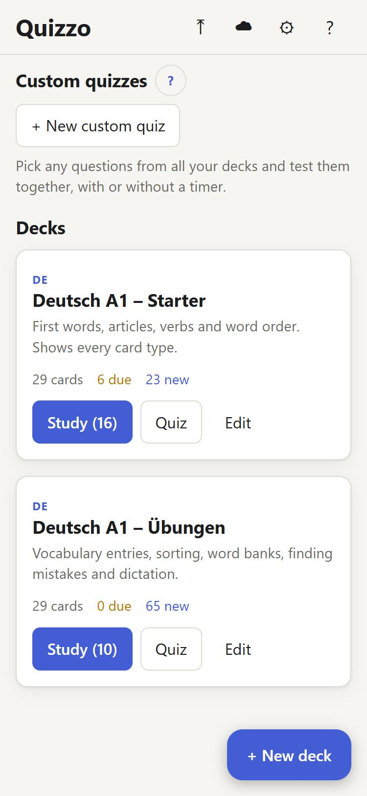
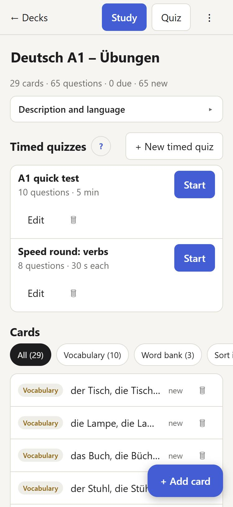
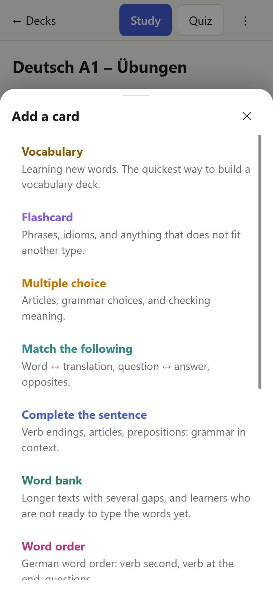
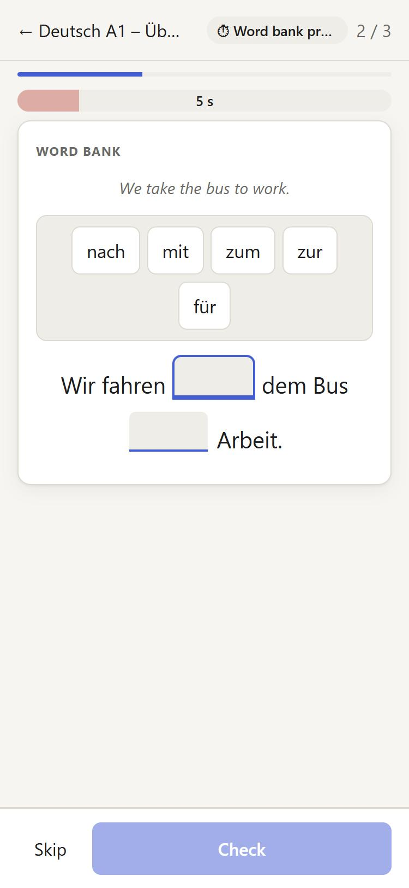
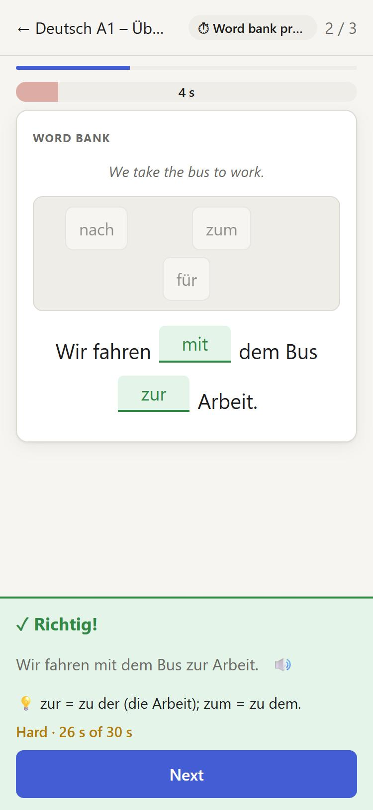

<h1 align="center">
  <br>
  Quizzo
</h1>

<p align="center"><b>Flashcards that quiz you back.</b></p>

<p align="center">
  <a href="https://github.com/AnshKapoor/quizzo/releases/latest"></a>
  
</p>

Quizzo is a study app for language learners. Instead of only flipping cards, it asks you in twelve different
ways: fill the gaps, put words in order, sort into groups, find the mistake, write what you hear, and more. It
runs on Android and on the desktop (Windows, macOS, Linux) from one codebase, works offline, and keeps your
decks as plain JSON files that are easy to share. It ships with two German A1 decks to start with.

<p align="center">
  
  
  
  
  
</p>

## Download

Get the latest version from [Releases](https://github.com/AnshKapoor/quizzo/releases/latest):

| Device  | File                                                       |
|---------|------------------------------------------------------------|
| Android | `quizzo-x.y.z.apk`                                         |
| Windows | `Quizzo-Setup-x.y.z.exe` (installer) or `Quizzo-Portable-x.y.z.exe` |
| macOS   | `Quizzo-x.y.z-mac-arm64.dmg` (Apple silicon) or `-mac-x64.dmg` (Intel) |
| Linux   | `Quizzo-x.y.z-linux-x86_64.AppImage`                       |

The desktop apps aren't code-signed, so Windows SmartScreen and macOS Gatekeeper warn on first start. On
Android, allow installing from your browser or file manager when asked.

## What it does

- **Twelve question types** (table below), all usable by tapping or dragging.
- **Study** with spaced repetition: cards that are due plus up to 10 new ones; missed cards come back once at the end.
- **Quiz** against the clock: every question has its own timer, and faster right answers get a better mark.
- **Timed quizzes** saved with a deck: number of questions, a time limit for the whole quiz and/or per question,
  optional card-type and tag filters, a per-question review at the end, and your last results.
- **Custom quizzes** that mix questions from any of your decks.
- **Make your own cards** in an editor with a live preview, pictures, hints and explanations. Built-in help has a
  playable example of every card type.
- **Backup to your own Google Sheet** and restore on any device; each device keeps one latest backup, and you can
  save named backups on the side. Also available as a single backup file.
- **Share decks** as `.json` files ([format](docs/deck-format.md)).
- **Make it yours**: 14 themes, 8 fonts, text size and card styles.
- A short **guided tour** on first start shows where everything is.

## Card types

| Type                  | How it works                                                      |
|-----------------------|-------------------------------------------------------------------|
| Vocabulary            | Enter a word once; generates up to 5 questions (both directions, article, plural, meaning) |
| Flashcard             | Flip, then grade yourself Again / Hard / Good / Easy              |
| Multiple choice       | One answer, or "select all that apply"                            |
| Match the following   | Pair the items in two shuffled columns (tap or drag)              |
| Complete the sentence | Type into the blanks (ä/ö/ü/ß buttons; ae/oe/ue/ss accepted)      |
| Word bank             | The missing words sit jumbled in a box on top; drag each into its gap. Works for whole paragraphs |
| Word order            | Build the sentence from word tiles (tap or drag); other valid orders allowed |
| Sort into groups      | Drag words into groups such as der / die / das                    |
| Find the mistake      | Tap the wrong word(s); corrections shown afterwards              |
| Dictation             | Listen (normal or slow) and type; missed words highlighted       |
| Sequence              | Drag lines into the right order (conversations, routines, days)  |
| Fill the table        | Drag words into table cells, e.g. a conjugation table            |

Drag and drop uses pointer events, so it works with mouse and touch; every drag can also be done by tapping.

While answering, the question stays fixed at the top and the Check button sits in a bar at the bottom of the
screen; the result, the correct answer and the explanation appear in that same bar. A hint, if the card has one,
is available from the card's corner before you answer.

## Backup and other devices

☁ Backup on the start screen backs up everything (decks, quizzes, progress, results, appearance) to a **Google
Sheet** of your own. Set up once: create a Sheet, paste the Apps Script that Quizzo shows into
*Extensions → Apps Script*, deploy it as a web app (Execute as: Me, Who has access: Anyone) and paste its URL into
Quizzo. Other devices connect with the *connection link* (URL + private key); keep that link private.

Each backup replaces the previous one from the same device, optionally automatically about 30 s after changes.
Type a name and press *Save as separate backup* to keep a copy that is never overwritten. Restoring either
replaces everything (with undo) or merges card by card.

Other features: text-to-speech (🔊, desktop/browser), keyboard shortcuts on the desktop (Space reveals, 1–4 grade,
Enter next, Esc exits).

## Stack

- **React + TypeScript + Vite**: the whole app, one codebase (`src/`)
- **Electron**: desktop shell (`electron/`), packaged with electron-builder. Library saved to `%APPDATA%\Quizzo\library.json`
- **Capacitor**: Android shell (`android/`). Library saved in the WebView's IndexedDB (also used by the browser version)

## Building from source

```bash
npm install
```

Browser (fastest while developing):
```bash
npm run dev
```

Desktop app:
```bash
npm run desktop
```

Desktop with hot reload (start `npm run dev` first, in another terminal):
```bash
npm run desktop:dev
```

Desktop installers (written to `release/`; `dist:win` for Windows only):
```bash
npm run dist
```

Android (needs Android Studio + JDK 21):
```bash
npm run android:sync
```
```bash
npm run android:open
```
Then press Run in Android Studio.

### Releases

Pushing a version tag builds the signed Android APK and the desktop apps (Windows installer + portable .exe,
macOS .dmg, Linux AppImage) on GitHub Actions and publishes them together under
[Releases](https://github.com/AnshKapoor/quizzo/releases)
([workflow](.github/workflows/release.yml)). The desktop apps aren't code-signed, so Windows SmartScreen and
macOS Gatekeeper warn on first start.
```bash
git tag v0.1.1
```
```bash
git push origin v0.1.1
```
The signing key is not in the repo. It lives in `~/.quizzo-signing/` (keep it backed up: Android only
accepts updates signed with the same key) and as the repository secrets `ANDROID_KEYSTORE_BASE64`,
`ANDROID_KEYSTORE_PASSWORD` and `ANDROID_KEY_ALIAS`.

Tests and type checks:
```bash
npm test
```
```bash
npm run typecheck
```

## Layout

```
src/
  types.ts                 data model (= JSON schema)
  data/                    built-in decks (German A1 starter + practice); new ones reach existing installs once
  lib/                     answer checking, cloze parser, scheduler, validation, storage
  components/cards/        one component per card type
  screens/                 Home, DeckView, CardEditor, Study, TimedQuiz, QuizBuilder, Appearance, Backup, Help
  lib/cloud.ts             backup files + Google Sheet backup (includes the Apps Script users paste into their Sheet)
electron/                  desktop main + preload (JSON file storage, HTTP for cloud backup)
build/                     app icon (logo.webp is the source; scripts/make-icons.py builds every icon from it)
public/                    browser tab icon
android/                   generated Capacitor project
docs/deck-format.md        JSON deck format reference
docs/screenshots/          pictures used in this README
```

## Adding a new card type

1. Add the interface to `src/types.ts` and include it in the `Card` union.
2. Validate it in `src/lib/validate.ts`.
3. Map it to/from form fields in `src/lib/cardForm.ts` and add fields in `screens/CardEditor.tsx`.
4. Write `components/cards/XxxView.tsx` and register it in `CardView.tsx`.

## Known gaps / next steps

- Android: saving files (deck export, backup file) uses a browser download, which the WebView can't do. Add
  `@capacitor/filesystem` + `@capacitor/share`. Google Sheet backup works there.
- Android: no text-to-speech in the WebView yet (needs a Capacitor TTS plugin), so dictation falls back to showing
  the sentence. Store the library in a file rather than WebView storage.
- Vocabulary: start new words as multiple choice and switch to typing once they're known.
- Desktop: code signing, auto-update (electron-updater), use the app icon for Android too.
- Card ideas: rewrite-the-sentence, label a picture, reading passages, speaking.
- More languages: `deck.language.target` already drives TTS and the special-character bar.
